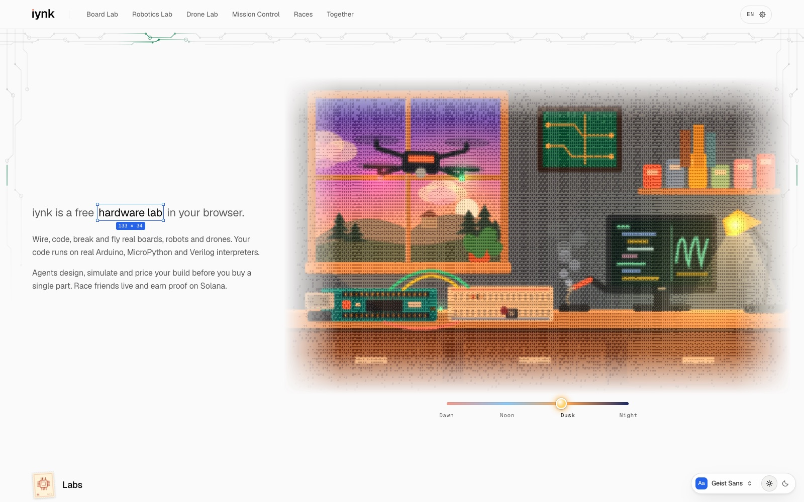
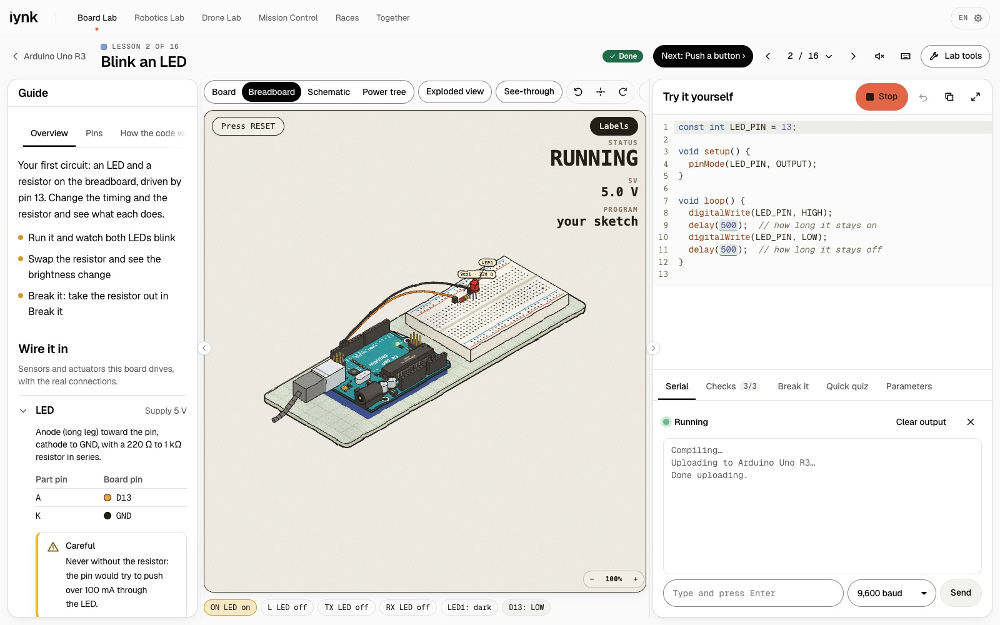
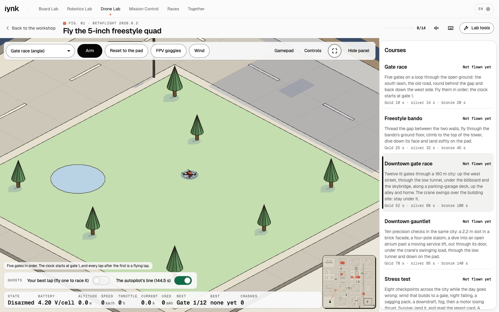
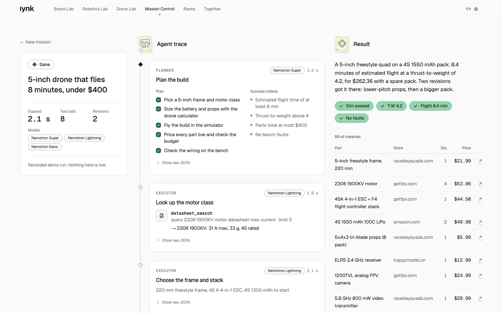
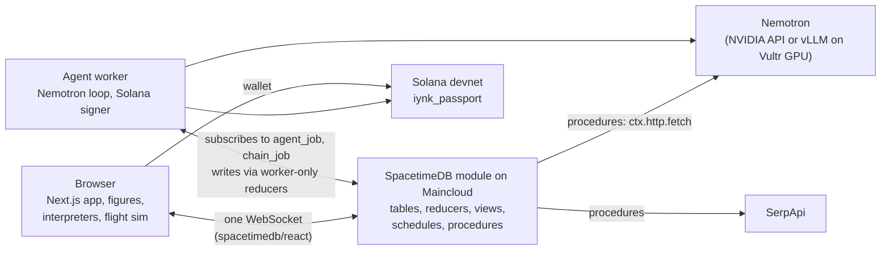

# iynk

**A free hardware lab in your browser.** Wire, code, break and fly real boards, robots and drones without buying a
single part, in your own language, and never alone.



## Why

Learning hardware is mostly experimenting, and experimenting means breaking things. Every mistake costs a part: a
board, a sensor, a motor driver, a battery. Far from a lab, a makerspace or a well-stocked shop, that cost is where a
lot of people stop. iynk moves the experimenting into a lab that behaves like the real hardware, so the only thing you
ever have to buy is the final prototype.

## What it does

### Three labs, 38 real items

| Lab | Items |
|---|---|
| **Board Lab** | Arduino Uno R3, Arduino Nano, Arduino UNO R4 (Minima, WiFi), ESP32-DevKitC V4, ESP32-S3-DevKitC-1, NodeMCU (ESP8266), Raspberry Pi Pico (W, 2), STM32 Nucleo-F401RE, BBC micro:bit V2, Raspberry Pi 5 / Pi 4, Digilent Basys 3, Terasic DE10-Lite |
| **Robotics Lab** | Build an Arduino Uno R3, LED + resistor, transistor motor switch, build an ESP32-S3-DevKitC-1, TB6612FNG driver, L298N driver, A4988 stepper driver, PCA9685 servo arm, MPU-6050 tilt alarm, HC-SR04 parking sensor, QTR-8RC line follower, LM2596 buck converter, Raspberry Pi 5 ROS 2 brain |
| **Drone Lab** | 5-inch freestyle quad, Tiny Whoop 65 mm, 3-inch cinewhoop, 7-inch long-range quad, 5-inch racing quad, GPS camera drone, autonomous delivery quad, agricultural spray hexacopter, 900 mm FPV flying wing, VTOL tiltrotor, Crazyflie swarm drone, tricopter, heavy-lift octocopter |

Every item is a hand-inked 3D figure you can turn all the way round, see through and take apart.

- **Real code, really run.** Write Arduino C++, MicroPython, Python (gpiozero and rclpy on the Pi) or Verilog on the
  FPGA boards and press Run. Interpreters inside the page drive the pins, the serial monitor and the figure on a
  deterministic clock. 71 board lessons and 31 bench tasks pass only when your run meets their checks.
- **Break it on purpose.** 144 board failures and 106 bench faults, decided by a circuit solver: leave the resistor off
  an LED and it flashes once and burns out (113 mA through a part rated for 20), fit a capacitor backwards and it
  smokes, put a motor on the 5 V pin and the board browns out. Each one explains what happened and how to fix it.
- **Fly it.** A flight sim with gate races and freestyle courses in angle or acro mode, third person or FPV, against
  your best lap and other pilots' ghosts. The 5-inch quad also flies a 160 m downtown: a 12-gate race through
  alleys, a tunnel, under a skybridge and a swinging crane; a precision gauntlet (a 2.2 m window slot, a slalom, an
  atrium dive past a moving lift); and a stress test where wind builds to a gale, night and fog fall, the pack sags
  and a motor fades. The report card explains the crash with the numbers from your own build.





### Mission Control: Nemotron agents that build with the real simulators

Give it a goal ("a 5-inch drone that flies 8 minutes for under $400", "my LED trainer is dark") and watch a team of
Nemotron models work it out live:

```
goal ─► planner (Nemotron Super, thinking on) ─► executor (Nemotron Lightning) ⇄ tools ─► critic (Super) ─► result
                                                                                   ▲                 │
                                                                                   └──── revise ◄────┘
```

The tools are the same engines the lab runs, not descriptions of them: the drone calculator, a budget optimiser over
every battery/motor/prop combination at live prices, the board interpreters with lesson checks, the bench fault
model, live part prices and datasheet search. The critic checks the tool evidence against the plan's success criteria
and sends the executor back with concrete fixes. Every step, tool call and timing streams into the page as it
happens. The result is a verified design and a priced parts list that loads straight into the lab. Changes to your
bench arrive as proposals you accept or reject.



### Never alone

- **Rooms.** Share a link and up to eight people build on the same bench in real time. Every shared action goes
  through one SpacetimeDB reducer that gives it a sequence number, so everyone sees the same order.
- **A lab partner.** Reads your bench, points at the broken part in the figure and gives hints before answers. If
  someone in your room has passed that lesson, it asks them first.
- **Any language.** The whole app is in English, Spanish, French, German, Chinese and Hindi, down to the labels inside
  the figures. Room chat is translated into each reader's language by a module procedure that calls Nemotron.

### Proof of Build and prize races on Solana

- **Credentials.** Pass a drone's bench safety checks and the SpacetimeDB module re-runs your exact run log. Only then
  does it queue a chain job, and the worker's issuer writes a credential to your wallet through the `iynk_passport`
  Anchor program on devnet. Anyone can verify it from the chain on `/verify`.
- **Prize races.** A sponsor locks SOL in a race pool for a course. Pilots enter from their wallet. Laps are recorded
  and ranked in SpacetimeDB, and when the race closes a scheduled reducer queues the results and the settlement,
  which pays the winners from the pool on-chain.

## How it works



- **SpacetimeDB is the backend.** Rooms, chat and translations, presence, cursors and flight ghosts (event tables),
  progress, laps and leaderboards, live activity, buddy profiles, agent jobs and their steps, races, credentials and
  the chain job queue are all tables in one TypeScript module (`spacetime/`). Rate limits, run verification and race
  closing happen in reducers. Translation and search are procedures that call out over HTTP. Timers (race close,
  empty-room cleanup, buddy expiry, the activity rollup) are scheduled reducers. The contract is in
  [docs/ARCHITECTURE.md](docs/ARCHITECTURE.md).
- **Security:** every client is treated as hostile; what is private, who can call what and how laps and credentials are
  checked is in [docs/SECURITY.md](docs/SECURITY.md).
- **The worker** (`worker/`) is a Node service that logs in as the registered worker identity. It runs the Nemotron
  agent loop for queued jobs and signs Solana transactions for queued chain jobs. It also mirrors on-chain race
  events back into the module.
- **Frontend:** Next.js 16 (App Router), React, TypeScript, Tailwind CSS, CodeMirror. Figures are SVG drawn with
  [Colorfigures](figures/vendor/colorfigures/LICENSE), with our own engines for boards, benches and drones
  ([figures](docs/FIGURES.md), [bench engine](docs/FIGURES-BENCH.md), [drone engine](docs/FIGURES-DRONE.md)).
- **Simulation:** interpreters for an Arduino C++ subset, MicroPython, Python and a Verilog subset, a circuit solver,
  a drone calculator and a flight model, all in the browser.
- **Chain:** an Anchor program (`solana/programs/iynk_passport`) with credentials and race pools, tested on a local
  validator.
- **Hosting:** the SpacetimeDB module runs on Maincloud. A Vultr VM runs the worker, the web app and Caddy in
  Docker Compose, and an optional Vultr GPU serves Nemotron through vLLM. The module can also be self-hosted on
  the VM. See [docs/DEPLOY.md](docs/DEPLOY.md).

## Run it locally

Needs Node 24, npm and the [SpacetimeDB CLI](https://spacetimedb.com/install) 2.14.

```bash
npm ci
cp .env.example .env.local   # every key is optional; a feature without its key says it isn't set up
npm run stdb:start           # SpacetimeDB on 127.0.0.1:3100; leave it running
npm run stdb:publish         # build and publish the module as database "iynk"
npm run dev                  # http://localhost:3000
```

Mission Control needs the worker. It runs without any key against a scripted model, using the real tools:

```bash
npm --prefix worker install
NEMOTRON_FAKE=1 STDB_WORKER_SECRET=dev-worker-secret npm --prefix worker start
```

The labs, figures, interpreters and flight sim work with no keys and no SpacetimeDB at all. Keys in `.env.local`
turn on the rest:

| Variable | Turns on |
|---|---|
| `NVIDIA_API_KEY` (or `NEMOTRON_BASE_URL`) | Nemotron for the agents, the lab partner and Build Night planning |
| `SERPAPI_KEY` | live prices, places, events, videos and datasheet answers |
| `SOLANA_ISSUER_KEYPAIR`, `NEXT_PUBLIC_SOLANA_PROGRAM_ID` | credentials and prize races on devnet |

Module procedures read their keys from the database, not from `.env.local`. Pass them when you publish:
`NVIDIA_API_KEY=... SERPAPI_KEY=... npm run stdb:publish`.

## Tests

```bash
npm run typecheck        # TypeScript
npm run lint             # ESLint
npm test                 # Vitest, including every lesson's reference and starter code
npm run stdb:test        # the SpacetimeDB module
npm --prefix worker test # agent loop, tools, chain queue, race mirror
npm run e2e              # Playwright end-to-end tests with axe accessibility checks
cd solana && npm test    # the Anchor program on a local validator
```

## Project layout

```
spacetime          the SpacetimeDB module: schema, reducers, views, schedules, procedures
worker             the agent worker: Nemotron loop, tools, Solana chain queue, race mirror
src/app            pages and API routes (one page per lab item, in six languages)
src/components     lab UIs, Mission Control, races, the dock (partner, rooms, parts), shell
src/content        boards, benches and drones: lessons, steps, faults, checks
src/lib            interpreters, circuit solver, drone calculator, flight model, stdb client, AI, search, Solana
src/i18n           messages and lesson prose in six languages
figures            figure sources and engines (built into public/figures)
solana             the Anchor program, its tests and deploy scripts
deploy             Docker Compose and Caddy for the Vultr VM
e2e                Playwright tests
docs/facts         sourced fact sheets for every board and drone
```

## Credits

- [Colorfigures](figures/vendor/colorfigures/LICENSE) by April Zhu (MIT), built on iso-glow by April Zhu and
  iso-figure by Tolga Cohce. Our changes are in `figures/vendor/colorfigures/PATCHES.md`.
- Learn Arduino by Dilum Sanjaya, Robotics Engineer and Drone Engineer showed how good an interactive hardware lesson
  can be and shaped our lesson structure. We reused facts (pinouts, formulas, constants), not their code.
- The landing page's editorial layout is inspired by [kshv.me](https://www.kshv.me/).
